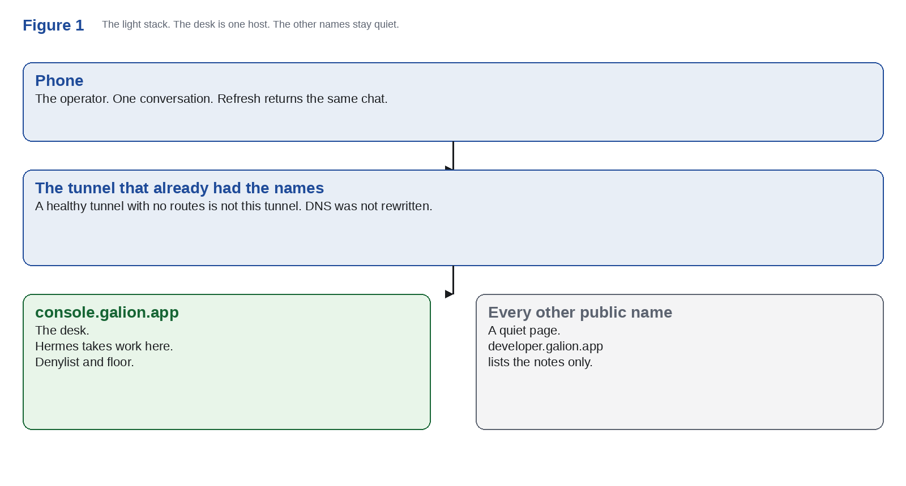

# Galion Labs

**G.A.L.I.O.N.** — General Autonomous Local Intelligence Open Network.

Your own AI, on hardware you own. Rust-first, CPU-light, loopback by default (`127.0.0.1`), under the Perpetual Open MIT License.

[galion.app](https://galion.app) · [developer.galion.app](https://developer.galion.app) · [Public notes](https://github.com/galion-studio/community) · [Discussions](https://github.com/galion-studio/community/discussions)

---

## Core Stack

Every repository states what runs today, what is staged, and what is planned. Unrun gates stay open. No model invents citations or engineering numbers.

| Repository | Role | Stack | State |
| :--- | :--- | :--- | :--- |
| **[obsidian-open-mind](https://github.com/galion-studio/obsidian-open-mind)** | Local agent runtime, Landlock sandbox, and loopback console (`127.0.0.1:18181`) for ordinary CPUs. | Rust (75 crates) | CI passing; stack rows staged |
| **[galion-one-voice](https://github.com/galion-studio/galion-one-voice)** | One-orb real-time voice engine: 80 ms clock, consent-gated emotion band, out-of-process ASR/TTS. | Rust · Piper · Vosk | V2 active on loopback |
| **[hermes-research](https://github.com/galion-studio/hermes-research)** | Citation-gated research desk separating `Found`, `Inferred`, and `Unknown`. Offline-honest. | Node 22 (0 deps) | E2E + a11y passing |
| **[galion-knowledge](https://github.com/galion-studio/galion-knowledge)** | Base World Knowledge Pack and `truth-gate` source/evidence validator for HORBM retrieval. | Rust · Eleventy · Three.js | V2 static build + truth-gate |
| **[galion-operating-system](https://github.com/galion-studio/galion-operating-system)** | Linux + Rust OS profiles (voice-only `/dev/fb0` first, single-window GUI second) for PC and Pi 5. | Rust · Linux · Shell | `galion-init` prototype |

## Applied Science & Engineering

| Repository | Role | Rule |
| :--- | :--- | :--- |
| **[cargen](https://github.com/galion-studio/cargen)** *(Forge)* | Prompt-to-car engineering pipeline (OpenCourant explicit crash FEA, MFEM, Open CASCADE, Bevy). | Every engineering number comes from a validated solver or cited test (48 tube-crush tests indexed), never from the AI. |
| **[Corpus-Nova](https://github.com/galion-studio/Corpus-Nova)** | Interactive 3D human organism explorer and Nova Sheet biology/endocrinology white papers. | Primary literature cited; contested mechanisms kept side by side. |

---

## Latest Working Paper · GP-2026-01

**Testing Grok Build on a rented CPU.** 23 September 2026. One operator. No second rater. Not a benchmark.

[Read it](https://developer.galion.app/p/grok-build-paper) · [PDF](https://github.com/galion-studio/community/blob/main/2026-09-23/grok-build/galion-gp-2026-01.pdf) · [The day](https://github.com/galion-studio/community/tree/main/2026-09-23)

**Grade.** Useful. Not finished. Not something to leave alone for a week. Not a Grok-class computer.

| Behavior | Early | Late |
| --- | ---: | ---: |
| Follows the last instruction | 5 | 5 |
| Builds on the paid machine | 2 | 4 |
| Leaves the keeper processes alone | 1 | 4 |
| Speaks before a hidden think | 2 | 3 |
| Keeps secrets out of the transcript | 2 | 2 |
| Leaves a result you can open | 2 | 4 |

<strong>Figures & operator notes from GP-2026-01</strong>

 

### Also filed
- [The layer that wraps everything](https://developer.galion.app/p/ald-gaa) — Research plan on rare-earth oxides (plan, not a replacement claim).
- [The ALD plan is live](https://developer.galion.app/p/ald-gaa-live) — Follow-up note.

---

## License

Perpetual Open MIT License · © 2024–2026 Galion Labs. Free forever; commercial use allowed; keep the copyright and permission notice with every copy.
