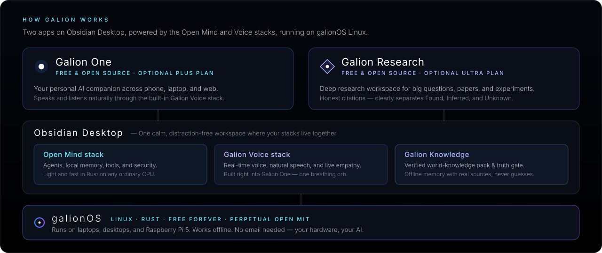

  <a href="https://galion.app"><strong>galion.app</strong></a> ·
  <a href="https://github.com/galion-studio/galion-operating-system">galionOS</a> ·
  <a href="https://github.com/galion-studio/obsidian-open-mind">Open Mind stack</a> ·
  <a href="https://github.com/galion-studio/community">Public Notes</a> ·
  <a href="https://github.com/galion-studio/community/discussions">Discussions</a>

  <strong>Your own AI, on everything you own.</strong> 
  Light and fast on ordinary computers, alive when you are offline, and open for everyone under the <strong>Perpetual Open MIT License</strong>.

---

## Architecture

### The System & Stacks

| | Project | What it is | Licence & Access |
| :---: | :--- | :--- | :--- |
|  | **[galionOS](https://github.com/galion-studio/galion-operating-system)** | Our Linux-based, Rust-powered operating system built around **Obsidian Desktop** — for laptops, PCs, and Raspberry Pi 5. | **Free forever** · Perpetual Open MIT |
|  | **[Open Mind stack](https://github.com/galion-studio/obsidian-open-mind)** | The agent, local memory, tool, and guardian stack that powers **Obsidian Desktop** on any ordinary CPU. *(Made by Galion; unrelated to the Obsidian notes app.)* | **Free forever** · Perpetual Open MIT |
|  | **[Galion Voice stack](https://github.com/galion-studio/galion-one-voice)** | The real-time voice and live-empathy stack inside **Galion One**. *"The seamless connection with the human being, on the voice only."* | **Free forever** · Perpetual Open MIT |
|  | **[Galion Knowledge](https://github.com/galion-studio/galion-knowledge)** | Open world-knowledge pack and truth gate. Every card carries real sources, weighed evidence, and honest unknowns. | **Free forever** · Perpetual Open MIT |

### The Apps on Obsidian Desktop

Both apps are **free and open source** to download and run on your own machine, with optional hosted cloud plans (**Plus** and **Ultra**, planned — no email required, your account is just a number):

| | App | What it does | Plans |
| :---: | :--- | :--- | :--- |
|  | **Galion One** · [galion.app](https://galion.app) | One personal companion across your phone, laptop, and browser — powered by the **Galion Voice stack** and **Open Mind stack**. | **Free** (open source, self-hosted) · **Plus** (hosted, planned) |
|  | **[Galion Research](https://github.com/galion-studio/hermes-research)** | Ask big questions and let your research agent do the reading. Separates what is **Found**, **Inferred**, and **Unknown** — never invents a source. | **Free** (open source, self-hosted) · **Ultra** (hosted, planned) |

---

## GalionLabs Research & Open Science

| | Project | What we are building |
| :---: | :--- | :--- |
|  | **[Forge (`cargen`)](https://github.com/galion-studio/cargen)** | **One prompt in, one car out.** Real crash, stiffness, and aero physics come first — every engineering number comes from a validated solver or published test, never guessed by AI. |
|  | **[Corpus Nova](https://github.com/galion-studio/Corpus-Nova)** | Free, interactive 3D human body explorer, universal biology library, and **Nova Sheet** white papers open to everyone. |
|  | **[Public Notes (`community`)](https://github.com/galion-studio/community)** | Open engineering notes and working papers from **GalionLabs**, filed by date (including **GP-2026-01**: *Testing Grok Build on a rented CPU*). |

<strong>Read Working Paper GP-2026-01 — Testing Grok Build on a rented CPU</strong>

 

[Open PDF](https://github.com/galion-studio/community/blob/main/2026-09-23/grok-build/galion-gp-2026-01.pdf) · [2026-09-23 folder](https://github.com/galion-studio/community/tree/main/2026-09-23)

**Grade.** Useful. Not finished. Not something to leave alone for a week.

| Behavior | Early | Late |
| --- | ---: | ---: |
| Follows the last instruction | 5 | 5 |
| Builds on the paid machine | 2 | 4 |
| Leaves the keeper processes alone | 1 | 4 |
| Speaks before a hidden think | 2 | 3 |
| Keeps secrets out of the transcript | 2 | 2 |
| Leaves a result you can open | 2 | 4 |

---

  <strong>G.A.L.I.O.N.</strong> — General Autonomous Local Intelligence Open Network 
  Developed by <strong>GalionLabs</strong> · <strong>Perpetual Open MIT License</strong>

