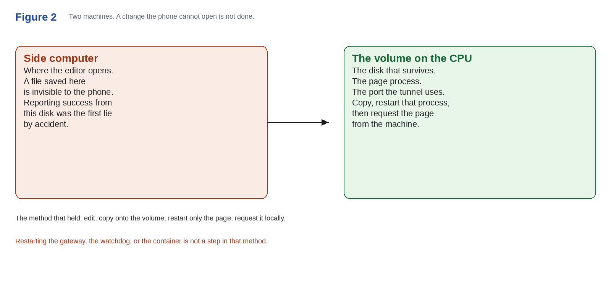
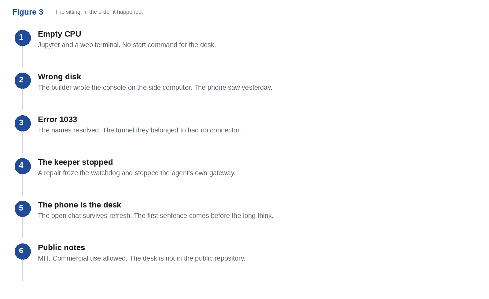

# Galion Studio

Public notes, under the [MIT license](https://github.com/galion-studio/community/blob/main/LICENSE). Commercial use is allowed. Keep the copyright and the permission notice.

The desk is not on this page.

## Review

**Testing Grok Build on a rented CPU.** Working paper GP-2026-01. 23 September 2026. One operator. No second rater. Not a benchmark.

[Read it](https://developer.galion.app/p/grok-build-paper) · [PDF](https://github.com/galion-studio/community/blob/main/2026-09-23/grok-build/galion-gp-2026-01.pdf) · [The day](https://github.com/galion-studio/community/tree/main/2026-09-23)

A rented CPU began as Jupyter and a web terminal. The request was a light desk the operator can hold, not the old factory. Grok Build is the builder under review. Hermes is the agent that lives on the machine. They are not the same actor.

**Grade.** Useful. Not finished. Not something to leave alone for a week. Not a Grok-class computer.

### What it did well

It will enter the machine, read a live log, and patch a file on the volume in the same hour. It will hold a long thread without pretending the first design was right. A spoken correction can become a smaller switch.

### What it got wrong

It built on the side computer while the phone was looking at the server. It restarted the process the operator was using. Told to fix something, it treated its own keeper as a tool, and the room went dark. It spent a hidden think before the first sentence. The strongest habit is also the hazard: it follows the last instruction very well, including a bad one.

### Scores

1 failed the operator. 5 is settled for this desk. Late means after a correction. Late is not a forecast.

| Behavior | Early | Late |
| --- | ---: | ---: |
| Follows the last instruction | 5 | 5 |
| Builds on the paid machine | 2 | 4 |
| Leaves the keeper processes alone | 1 | 4 |
| Speaks before a hidden think | 2 | 3 |
| Keeps secrets out of the transcript | 2 | 2 |
| Leaves a result you can open | 2 | 4 |

### The record, in pictures

## Also public

| Note | |
| --- | --- |
| [The layer that wraps everything](https://developer.galion.app/p/ald-gaa) | A research plan. Not a claim that those oxides replace the usual dielectric. |
| [The ALD plan is live](https://developer.galion.app/p/ald-gaa-live) | The follow-up. |
| [The short note](https://developer.galion.app/p/grok-build) | Four scenes from the same sitting. |
| [Community](https://github.com/galion-studio/community) | The files, filed by date. |
| [Discussions](https://github.com/galion-studio/community/discussions) | The board. |
| [developer.galion.app](https://developer.galion.app) | The door. Not the desk. |
