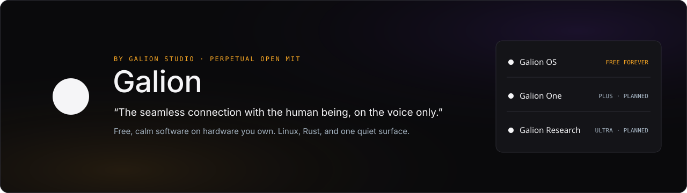
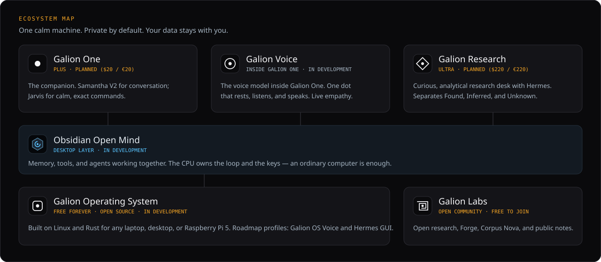
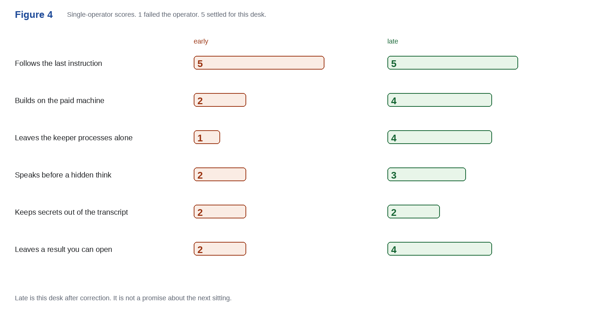

  <a href="https://galion.app"><strong>galion.app</strong></a> ·
  <a href="https://github.com/galion-studio/galion-operating-system/blob/main/docs/brand/BRANDING-V2.md">Brand guide</a> ·
  <a href="https://github.com/galion-studio/galion-operating-system/blob/main/labs/README.md">Galion Labs</a> ·
  <a href="https://github.com/galion-studio/community">Public notes</a> ·
  <a href="https://github.com/galion-studio/community/discussions">Discussions</a>

**Galion** is calm, private software that runs on hardware you own. A GPU is not the premise. The CPU owns the loop, and your data stays with you.

---

## Ecosystem

| | Name | What it is | Status |
| :---: | :--- | :--- | :--- |
|  | **[Galion Operating System](https://github.com/galion-studio/galion-operating-system)** | Free forever, open-source operating system built on Linux and Rust, from a laptop to a Raspberry Pi 5. Two roadmap profiles: **Galion OS Voice** (one dot) and **Hermes GUI**. | In development · Free forever |
|  | **[Obsidian Open Mind](https://github.com/galion-studio/obsidian-open-mind)** | The desktop layer inside Galion OS. Memory, tools, and agents live here on an ordinary CPU. *(A Galion project; not affiliated with the Obsidian note-taking app.)* | In development · Open source |
|  | **[Galion Voice](https://github.com/galion-studio/galion-one-voice)** | The voice model inside **Galion One** (Plus, planned at $20 / €20 per month). One dot on the surface. **Samantha V2** is the warm conversational persona; **Jarvis** is the calm command layer. | In development · Billing not live |
|  | **[Galion Research](https://github.com/galion-studio/hermes-research)** | Curious, analytical research desk (Ultra, planned at $220 / €220 per month). Hermes is the path behind the voice. Separates what is Found, Inferred, and Unknown. | In development · Billing not live |
|  | **[Galion Knowledge](https://github.com/galion-studio/galion-knowledge)** | Open world-knowledge pack for Galion Research. Every claim names its source, weighs the evidence, and keeps disputed views side by side. | In development · Open source |

---

## Galion Labs & Open Science

**Galion Labs** is the open community and research arm of Galion. Joining is free.

| | Project | What it is | Status |
| :---: | :--- | :--- | :--- |
|  | **[Forge (`cargen`)](https://github.com/galion-studio/cargen)** | One prompt in, one car out — physics first. Every engineering number comes from a validated solver or a cited crash test, never from the AI. | In development · P1a validation |
|  | **[Corpus Nova](https://github.com/galion-studio/Corpus-Nova)** | Free, open-source 3D human organism explorer, universal body library, and Nova Sheet biology white papers. | In development · White Paper #1 |
|  | **[Public Notes (`community`)](https://github.com/galion-studio/community)** | Daily notes and working papers from Galion Studio, filed by the day they were written. | Open record |

---

## Working Paper · GP-2026-01

**Testing Grok Build on a rented CPU.** 23 September 2026. One operator. No second rater. Not a benchmark.

[PDF](https://github.com/galion-studio/community/blob/main/2026-09-23/grok-build/galion-gp-2026-01.pdf) · [The day's folder](https://github.com/galion-studio/community/tree/main/2026-09-23)

**Grade.** Useful. Not finished. Not something to leave alone for a week. Not a Grok-class computer.

<strong>Scores and figures from GP-2026-01</strong>

 

1 failed the operator. 5 is settled for this desk. Late means after a correction. Late is not a forecast.

| Behavior | Early | Late |
| --- | ---: | ---: |
| Follows the last instruction | 5 | 5 |
| Builds on the paid machine | 2 | 4 |
| Leaves the keeper processes alone | 1 | 4 |
| Speaks before a hidden think | 2 | 3 |
| Keeps secrets out of the transcript | 2 | 2 |
| Leaves a result you can open | 2 | 4 |

---

## Pricing & Licence

Galion OS is **free forever** and open source. **Plus** is Galion One ($20 / €20 per month, planned). **Ultra** is Galion Research ($220 / €220 per month, planned). Billing is not live (`paid_tiers` stays false). Galion Labs is free to join.

All current Galion builds and notes are open source under the **Perpetual Open MIT License**.

Steward: Maciej Grajczyk, Galion Studio.  
Copyright (c) 3000 Galion / galion-studio.
